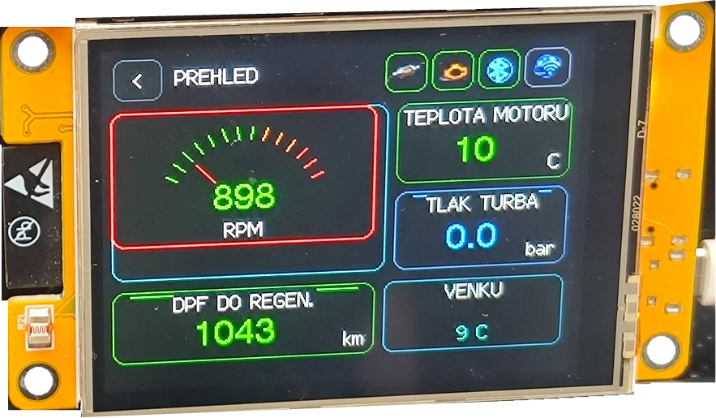
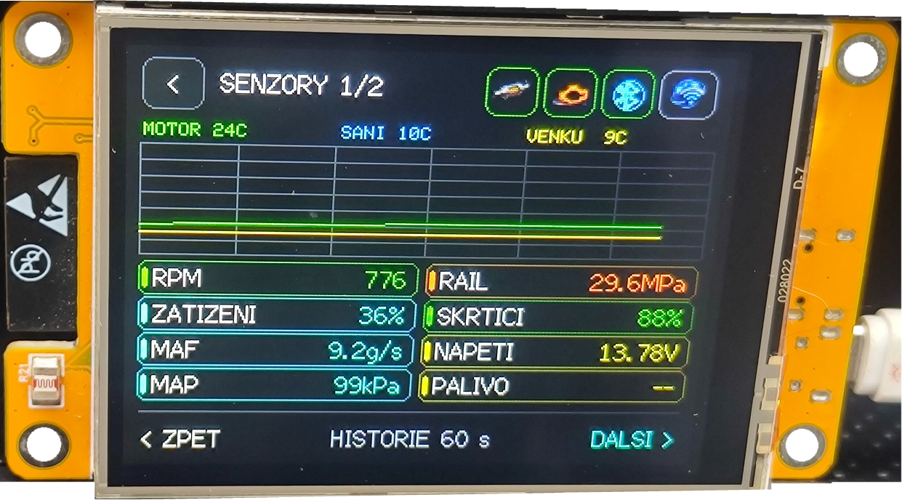
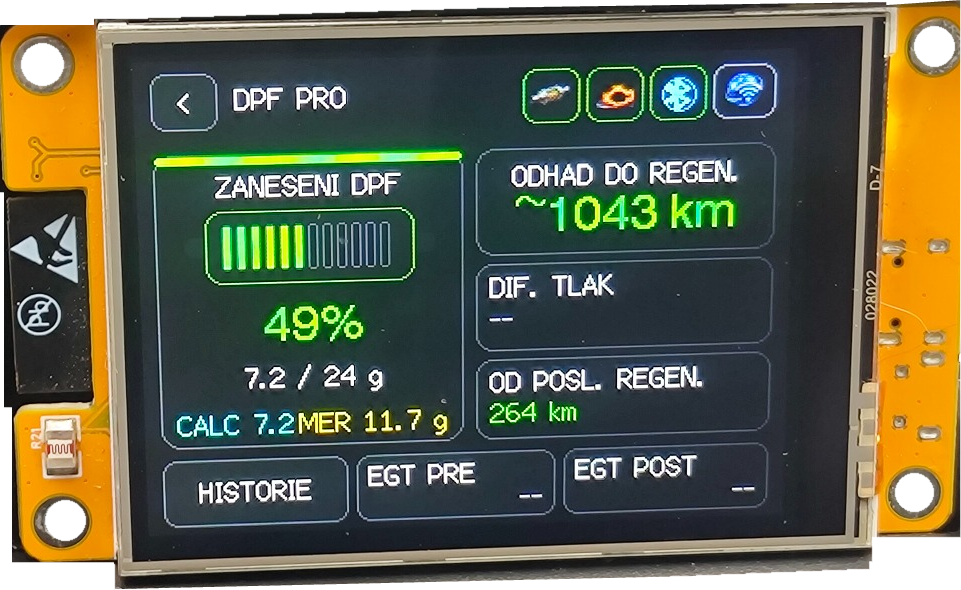
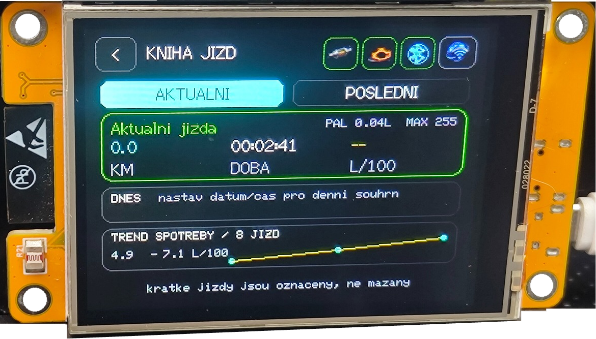

# Octavia II PC

**Octavia II PC** je neoficiální komunitní palubní počítač a diagnostický displej pro **Škoda Octavia II (1Z)** postavený na **ESP32-2432S028R / CYD 2.8" 320×240**.

Komunikuje přes **Bluetooth Classic ELM327**, zobrazuje dostupná data motoru, vede knihu jízd a historii tankování a nabízí servisní Wi‑Fi web.

**Aktuální veřejná verze:** `V16.31 MULTI-ECU`


> Nově firmware není pevně svázán pouze s 1.6 TDI CAYC. Umí automatický výběr OBD protokolu a používá profily ECU. Pokud konkrétní proprietární hodnotu nezná, raději zobrazí `-- / N/A`, než aby ji odhadoval.

---

## Kompatibilita motorů

| Profil | Stav | Co očekávat |
|---|---|---|
| **AUTO** | doporučeno | Firmware zkusí VAG CAN a při neúspěchu automatický OBD protokol. Poté zvolí nejbezpečnější profil. |
| **1.6 TDI CAYC / PCR2.1** | nejlépe ověřeno | Standardní OBD + UDS. Rozšířené DPF hodnoty jsou povoleny jen pro ověřené mapování ECU. |
| **2.0 TDI CR / EDC17** | základní podpora | Standardní OBD, identifikace UDS a na podporovaných CAN autech read-only scan jednotek. Proprietární DPF saze zatím nejsou vydávány za ověřené. |
| **1.9 / 2.0 TDI PD / EDC16** | základní podpora | Generic OBD přes protokol vybraný ELM327. Funkce závisí na tom, které standardní PIDy konkrétní ECU poskytuje. |
| **Generic OBD-II** | bezpečný fallback | RPM, rychlost, teploty a další standardní PIDy podle podpory vozidla. |

**Důležité:** Octavia II se vyráběla s více motory, ECU a diagnostickými protokoly. Stejný údaj DPF proto nemusí mít na všech jednotkách stejnou adresu ani formát. V16.31 záměrně nepoužívá neověřené raw DPF DIDy na jiné ECU.

Podrobnosti jsou v [MULTI_ECU_SUPPORT.md](MULTI_ECU_SUPPORT.md).

---

## Co projekt umí

Stručně:

- palubní přehled s RPM, teplotou motoru, turbem a dalšími dostupnými hodnotami,
- automatickou detekci OBD protokolu a profil motoru/ECU,
- DPF PRO na ověřených ECU a standardní DPF tlak, pokud jej ECU poskytuje,
- motorová, senzorová a elektrická data,
- knihu jízd a historii tankování,
- čtení diagnostických závad,
- servisní intervaly, alarmy a správu napájení,
- Bluetooth skener pro ELM327,
- servisní Wi‑Fi web pro historii, nastavení a exporty.

Firmware je především **doplňkový informační displej**. Běžná diagnostika a identifikace ECU jsou read-only. Funkce **SPECIALS** obsahuje aktivní výstupní test a je proto v MULTI-ECU verzi povolen pouze pro ověřený profil.

---

## Ukázky z reálného displeje

<table>
  <tr>
    <td width="50%" align="center">
      <br>
      <b>Přehled</b>
    </td>
    <td width="50%" align="center">
      <br>
      <b>Senzory</b>
    </td>
  </tr>
  <tr>
    <td width="50%" align="center">
      <br>
      <b>DPF PRO</b>
    </td>
    <td width="50%" align="center">
      <br>
      <b>Kniha jízd</b>
    </td>
  </tr>
</table>

> Fotografie jsou z reálného provozu na ESP32-2432S028R / CYD.

### Další obrazovky firmware

| Přehled | Motor | Turbo |
|---|---|---|
|  |  |  |

| Kniha jízd | Tankování | Diagnostika |
|---|---|---|
|  |  |  |

---

## Hardware

Potřebujete:

- **ESP32-2432S028R / CYD 2.8" 320×240**,
- datový USB kabel,
- Arduino IDE 2.x,
- **Bluetooth Classic / SPP ELM327**,
- vozidlo s OBD komunikací.

Wi‑Fi ELM327 ani BLE-only adaptéry nejsou určeny pro aktuální způsob komunikace firmware.

---

## Instalace

### 1. ESP32 core

V Arduino IDE přidejte do **Additional Boards Manager URLs**:

```text
https://espressif.github.io/arduino-esp32/package_esp32_index.json
```

Projekt je připraven pro **Arduino-ESP32 3.3.x**.

### 2. Knihovny

V Library Manageru nainstalujte:

- `TFT_eSPI` – Bodmer
- `TFT_eWidget` – Bodmer
- `PNGdec` – Larry Bank / BitBank
- `XPT2046_Touchscreen` – Paul Stoffregen

### 3. Projekt

Hlavní soubory:

```text
Octavia_II_PC_v16_31_MULTI_ECU_PUBLIC/
├── Octavia_II_PC_v16_31_MULTI_ECU_PUBLIC.ino
├── MenuIcons.h
├── StartupLogo.h
├── User_Setup.h
└── README.md
```

Název složky musí odpovídat názvu hlavního `.ino` souboru.

### 4. TFT_eSPI

Soubor `User_Setup.h` z projektu použijte jako aktivní konfiguraci knihovny `TFT_eSPI`. Původní soubor si předem zazálohujte.

### 5. Deska

Použijte odpovídající CYD profil nebo například:

```text
Board:            ESP32 Dev Module
Flash Size:       4 MB
Partition Scheme: Huge APP (3MB No OTA / 1MB SPIFFS)
Serial Monitor:   115200 baud
```

Poté proveďte **Verify** a **Upload**.

---

## První spuštění

PUBLIC verze neobsahuje žádnou cizí MAC adresu ELM327 ani osobní údaje.

1. Otevřete Bluetooth scan a vyberte svůj **Bluetooth Classic ELM327**.
2. Uložte jej jako výchozí zařízení.
3. Profil motoru ponechte nejprve na **AUTO**.
4. Po připojení otevřete **NASTAVENÍ → PROFIL VOZIDLA** nebo servisní web a zkontrolujte detekovaný profil a ECU.
5. Nastavte název vozidla, kapacitu nádrže a případně stav tachometru.

Výchozí texty personalizace jsou záměrně:

```text
NASTAVTE NAZEV VOZIDLA
VOZIDLO NENASTAVENO
```

---

## Jak funguje MULTI-ECU režim

Po připojení ELM327 firmware:

1. nejprve zkusí **ISO 15765-4 CAN 11-bit / 500 kbit/s**,
2. pokud ECU neodpoví, přepne ELM327 na **automatický výběr OBD protokolu**,
3. ověří standardní OBD komunikaci,
4. na podporovaném CANu zkusí read-only UDS identifikaci ECU,
5. vybere profil motoru,
6. povolí pouze funkce, pro které má bezpečný zdroj dat.

U neznámé ECU zůstane aktivní **Generic OBD-II**. To není chyba, ale bezpečný fallback.

---

## DPF

Rozšířené hodnoty jako vypočítané/naměřené saze, stav regenerace a vzdálenost od regenerace jsou silně závislé na konkrétní ECU.

V16.31 proto:

- zachovává ověřený profil pro původně testovanou PCR2.1 ECU,
- na jiné ECU nepouští neověřené proprietární DPF mapování,
- zkouší standardní OBD DPF diferenciální tlak PID `7A`, pokud jej ECU podporuje,
- na nepodporovaném profilu zobrazí **N/A / neověřeno**, ne vymyšlenou hodnotu.

Pokud máte jinou Octavii II a chcete rozšířený DPF profil doplnit, nejcennější je identifikace ECU/ODX a porovnání hodnot s diagnostikou VCDS/ODIS.

---

## Servisní Wi‑Fi

```text
SSID:  Octavia-II-PC
Heslo: OctaviaPC
Web:   http://192.168.4.1
```

Servisní Wi‑Fi je oddělena od běžné Bluetooth OBD komunikace, aby ESP32 a rádio nebyly zbytečně zatěžovány současně.

---

## Personalizace PUBLIC verze

Přes nastavení nebo servisní web lze změnit zejména:

- úvodní text,
- horní název vozidla,
- profil motoru/ECU,
- kapacitu nádrže,
- stav tachometru,
- volitelné kontaktní údaje vlastníka/správce.

---

## Bezpečnost a omezení

- ESP32 **nepřipojujte přímo na 12–14,8 V** vozidla.
- Displej neovládejte během řízení způsobem, který odvádí pozornost.
- ELM327 klony se liší kvalitou a podporou příkazů.
- Dostupnost PIDů se může lišit i mezi dvěma vozy se stejným objemem motoru.
- `N/A` nebo `--` znamená, že firmware hodnotu nemá potvrzenou.
- Před použitím aktivních funkcí SPECIALS musí být vozidlo bezpečně odstavené.

---

## Licence a značka

**Octavia II PC** je neoficiální komunitní projekt. Není produktem ani oficiálním softwarem společnosti Škoda Auto a.s.

Použití je na vlastní odpovědnost.
